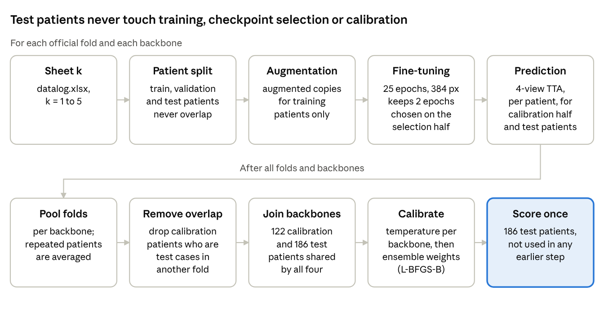
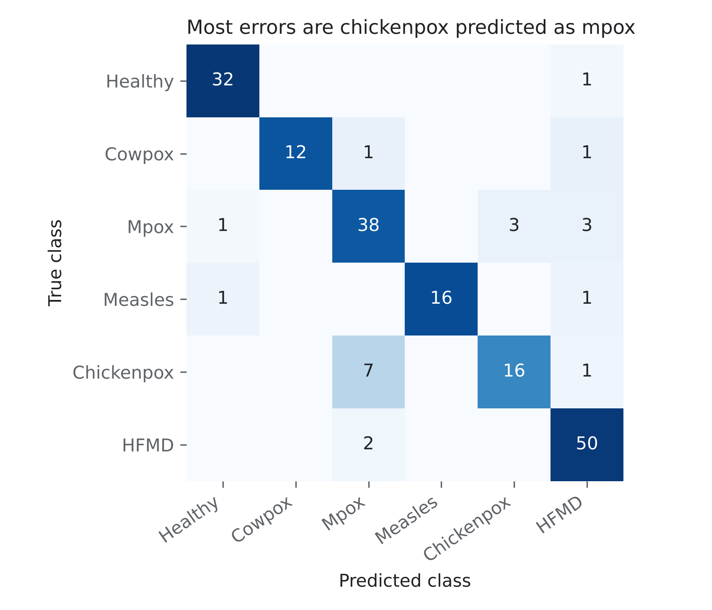
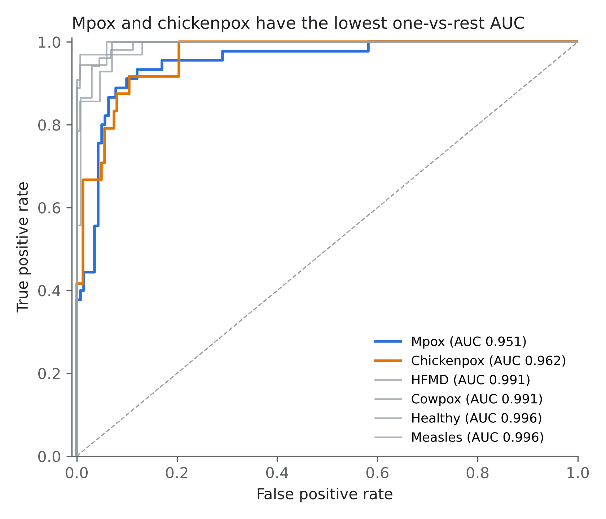
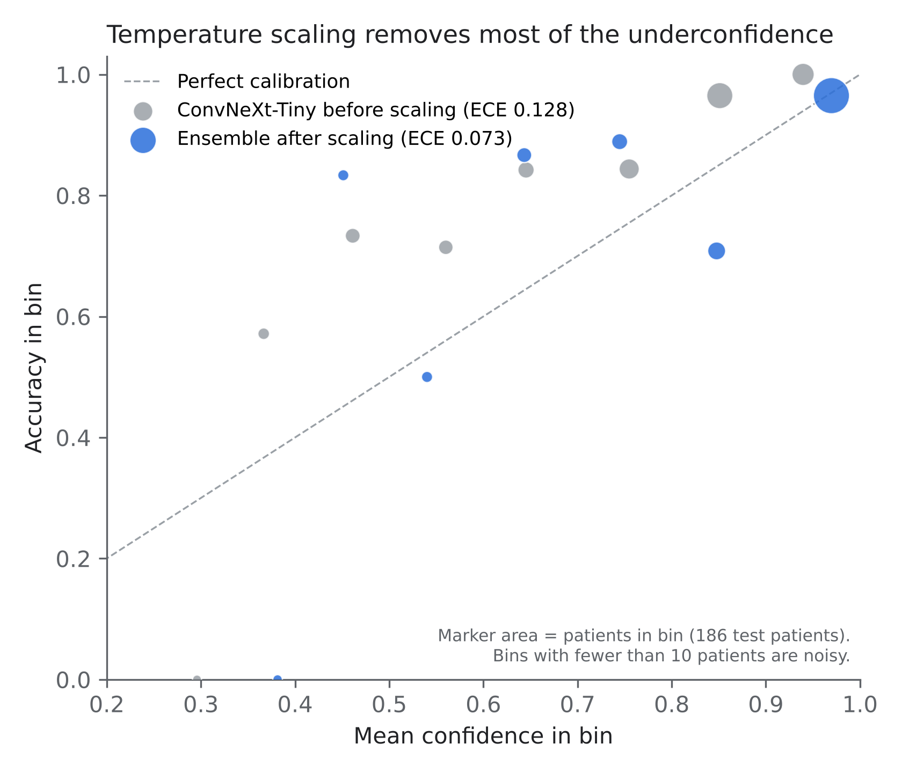

# Patient-level mpox skin lesion classification on MSLD v2.0

Code, saved predictions and logs for our study of six-class skin lesion classification on the Mpox Skin Lesion Dataset v2.0 (MSLD v2.0): a data leakage audit of the dataset, a controlled ablation that measures how much an image-level split inflates accuracy, and a calibrated CNN and transformer ensemble evaluated per patient.

> **Manuscript:** *Patient-level evaluation of deep learning for six-class mpox skin lesion classification: a data leakage audit of MSLD v2.0 and a calibrated CNN and transformer ensemble.* Under preparation. Citation details will be added here once it is published.

## Why this repository exists

Several papers on MSLD v2.0 report test accuracy above 90%. Many of them augment the images first and split the augmented pool at random afterwards. When that happens, a rotated or colour-shifted copy of a test photograph can sit in the training set, and so can other photographs of the same patient. The model is partly being tested on pictures it has already seen.

We wanted two numbers: how much that shortcut adds, and what accuracy holds up when every patient stays on one side of the split. Short answer: in our ablation the shortcut added about 35 percentage points (averaged over five seeds), and with patient-level evaluation the best ensembles land near 88%.

## Main findings

- **The public release has 524 patient IDs, not 541, and at most 520 distinct patients.** Counting patient IDs in the file names gives 524 across 755 original images; the dataset paper reports 541. Four pairs of IDs share a photograph.
- **The official folds are not a partition.** The five sheets of `datalog.xlsx` each assign all 755 images to train, validation or test, but their test parts overlap. Taken together they cover only 364 images (48.2%) and 216 patients, so "averaged over the five official folds" is not the same as "every image tested once".
- **Augmenting before splitting inflates accuracy by about 35 points.** With the same ViT-Tiny, image size and training budget, an image-level split of the augmented pool gave 85.32 ± 1.11% over five seeds. A patient-level split gave 50.34 ± 3.96%. The leaky pipeline won on every seed, by 30.5 to 40.2 points.
- **Patient-level accuracy sits near 88%.** Under the official folds with training-only augmentation (protocol B), a temperature-scaled ensemble reached 88.17% accuracy (95% CI 82.7 to 92.1%), macro F1 0.883, macro AUC 0.981 and ECE 7.26% on 186 held-out patients. Stratified group cross-validation (protocol A) gave 88.76%, but that figure is optimistic because model choices were made on the evaluated folds.
- **The ensemble could not be separated from temperature-scaled ConvNeXt-Tiny alone.** Most of the calibration gain comes from temperature scaling, not from combining models.
- **Chickenpox is the hard class.** Seven of 24 chickenpox patients were predicted as mpox.


## Update, November 2026

- **Duplicate photographs in MSLD v2.0.** Four pairs of patient IDs share a photograph (CHP_26_01/CHP_62_01, HFMD_130_01/HFMD_96_01, HEALTHY_21_01/HEALTHY_77_01, CWP_02_01/CWP_31_01), so the 524 IDs represent at most 520 people. Three pairs put an identical image in training and test of the official folds; removing the four affected test patients gives 160 of 182 correct (87.91%). Code: `src/mcvsld_audit/stage2b_msld_duplicate_pairs.py`, `src/analysis/duplicate_sensitivity.py`; results: `results/msld_duplicates/`.
- **MCVSLD is not an external test set.** In version 1 of the MCVSLD Mendeley archive (which we uploaded unchanged to Kaggle for processing), all 11,325 images are byte-identical MSLD v2.0 files with the same names (755 originals and 10,570 released augmentations). Code: `src/mcvsld_audit/`; results: `results/mcvsld_audit/`.
- **Ablation statistics.** The five-seed comparison is paired by seed, not by patient (the two pipelines use different test images). The leaky pipeline was ahead on 5 of 5 seeds; exact sign test p = 0.0625; t-based 95% CI of the gap 29.97 to 39.99 points (`src/analysis/leakage_seed_stats.py`).
- **ConvNeXt-Tiny weights.** The original runs never saved weights. `src/protocol_b/train_worker_v34w_convnext.py` is the V34 worker with weight saving added (diff in `v34_to_v34w.diff`); `compare_convnext_rerun.py` compares the re-run with the original predictions; `src/gradcam/gradcam_convnext.py` (and `notebooks/gradcam_convnext.ipynb`) produces qualitative Grad-CAM maps for ConvNeXt-Tiny only.

## Repository layout

```
mpox-msld-patient-level-audit/
├── README.md, requirements.txt, LICENSE, CITATION.cff, .gitignore
├── src/
│   ├── audit/dataset_audit.py             # patient counts, official folds, augmented pool
│   ├── mcvsld_audit/                       # Stage 1, 2, 2b: MCVSLD audit and MSLD duplicate-photo search
│   ├── ablation/                           # leakage ablation: two unseeded runs + 5-seed script
│   ├── analysis/                           # seed-level ablation statistics, duplicate sensitivity analysis
│   ├── protocol_a/train_sgkf_ensemble_v8.py
│   ├── protocol_b/                         # V34 worker, V34-W (weight saving), diff, merge, re-run comparison
│   ├── gradcam/gradcam_convnext.py         # qualitative Grad-CAM for ConvNeXt-Tiny
│   └── figures/make_figures.py
├── notebooks/                              # Kaggle notebooks for the audit, V34-W and Grad-CAM
├── results/
│   ├── predictions/                        # 24 saved arrays from protocol B
│   ├── protocol_b_merge/                   # report.json, confusion matrix, ROC points
│   ├── ablation_seeded/                    # per-run CSV, summary, seed-level statistics
│   ├── mcvsld_audit/                       # MCVSLD audit table and summaries
│   ├── msld_duplicates/                    # duplicate-photo pairs, fold placement, sensitivity analysis
│   └── logs/                               # Kaggle logs
├── figures/                                # Figs. 1 to 5
└── development/                            # earlier experiments, archived as run
```

## Data

MSLD v2.0 is public on Kaggle: [Mpox Skin Lesion Dataset Version 2.0 (MSLD v2.0)](https://www.kaggle.com/datasets/joydippaul/mpox-skin-lesion-dataset-version-20-msld-v20). It is not included here. Please follow the dataset's own licence and cite its authors:

> S. N. Ali *et al.*, "A web-based mpox skin lesion detection system using state-of-the-art deep learning models considering racial diversity," *Biomedical Signal Processing and Control*, vol. 98, 106742, 2024.

The release contains 755 original photographs in six classes, the five-sheet `datalog.xlsx`, and a folder of augmented images (`FOLDS_AUG`) with one sub-folder per fold.

### What the audit found

| Class | Images | Patients in file names | Patients reported |
|---|---:|---:|---:|
| Mpox | 284 | 133 | 143 |
| Chickenpox | 75 | 61 | 62 |
| Measles | 55 | 45 | 46 |
| Cowpox | 66 | 41 | 41 |
| HFMD | 161 | 141 | 144 |
| Healthy | 114 | 103 | 105 |
| **Total** | **755** | **524** | **541** |

| Official fold | Train | Validation | Test |
|---|---:|---:|---:|
| Sheet 1 | 537 | 144 | 74 |
| Sheet 2 | 509 | 164 | 82 |
| Sheet 3 | 538 | 153 | 64 |
| Sheet 4 | 524 | 150 | 81 |
| Sheet 5 | 538 | 154 | 63 |

The test partitions add up to 364 images, 48.2% of the dataset. `FOLDS_AUG` holds 37,044 files but only 10,570 distinct names (14 per original image), and 10,290 of those names appear in more than one fold folder. Each fold folder holds 14 copies of that fold's training images (7,518, 7,126, 7,532, 7,336 and 7,532 files). That 7,532 matches the training-set size reported by some earlier studies, which suggests they used one fold folder as their whole dataset.

There is also one non-clinical file, `Keywords.jpg`, at the dataset root. A loose parser can pick it up as an extra "mpox" image. Our protocol A code did, which is why protocol A reports 525 patients instead of 524.

## Experiments

### 1. Controlled leakage ablation (`src/ablation/`)

Same model (ViT-Tiny, `vit_tiny_patch16_224` at 128 px), same augmentation (original plus 9 MATLAB-style copies per image), Adam at 1e-3, batch 32, 100 epochs. The only difference is when augmentation happens.

Five seeded runs of each pipeline (`leakage_ablation_seeded.py`, raw results in `results/ablation_seeded/`):

| Pipeline | What happens | Test images | Accuracy, mean ± SD (95% CI) | Macro F1 |
|---|---|---:|---:|---:|
| 1A, image-level | augment all 755 images x10, then split 80:20 at random | 1,510 | 85.32 ± 1.11% (83.95 to 86.70) | 0.839 ± 0.013 |
| 1B, patient-level | split patients first, then augment training images only | 136 to 168 | 50.34 ± 3.96% (45.43 to 55.26) | 0.428 ± 0.048 |

| Seed | 0 | 1 | 2 | 3 | 4 |
|---|---:|---:|---:|---:|---:|
| 1A accuracy | 83.84% | 86.36% | 84.83% | 85.10% | 86.49% |
| 1B accuracy | 52.15% | 46.21% | 47.06% | 50.35% | 55.95% |
| Gap (points) | 31.7 | 40.2 | 37.8 | 34.7 | 30.5 |

The paired gap is 34.98 points (95% CI 29.97 to 39.99, paired t-test p < 0.001). In every 1A run, 100% of the test images had augmented copies of the same photograph in the training set, and 100% belonged to a patient who was also in training. That check is computed inside the script, so it is not an assumption.

Before the seeded repeats we ran the two pipelines without full seeding (`leakage_ablation_1A.py`, `leakage_ablation_1A_1B.py`): 1A gave 82.12% and 89.47%, 1B gave 62.14% (87 of 140). Those single runs sit on either side of, or above, the seeded range, which is why we report the seeded means. The seeded script writes one row per run to a CSV, resumes if a session restarts, and stops cleanly before Kaggle's time limit. Each run takes about 13 minutes on a T4, so all ten take a little over two hours.

### 2. Protocol A: stratified group cross-validation (`src/protocol_a/`)

Five folds of `StratifiedGroupKFold` over the original images, grouped by patient. Four ImageNet-pretrained backbones (EfficientNetV2-S, ConvNeXt-Tiny, Swin-Small, BEiT-Base) at 384 px, 25 epochs, mixup and CutMix early in training, 4-view test-time augmentation, confidence-weighted aggregation per patient. The top three backbones were combined with fitted temperatures and weights.

| Model | Patient accuracy (n = 525) |
|---|---:|
| Swin-Small | 88.57% |
| ConvNeXt-Tiny | 87.43% |
| BEiT-Base | 85.14% |
| EfficientNetV2-S | 72.76% |
| Ensemble (Swin, ConvNeXt, BEiT) | **88.76%** (95% CI 86.10 to 91.43%), F1 0.877, AUC 0.983, ECE 3.70% |

Read these as optimistic. Epochs, backbones, temperatures and ensemble weights were all chosen using the same out-of-fold predictions that produce the score. Protocol B was built to remove that.

### 3. Protocol B: official folds, nothing tuned on test patients (`src/protocol_b/`)



1. Each backbone is trained in its own run on the five official folds. Augmented images are used only if they belong to a training patient of that fold.
2. Each fold's validation patients are split in half. One half picks the two best checkpoints (by log-loss). The other half is kept for calibration.
3. The merge script drops calibration patients who are test patients of the same backbone in another fold, joins the four backbones on patient ID (122 calibration and 186 test patients), fits one temperature per backbone and then the ensemble weights, and scores the test patients once.

Results on the 186 test patients shared by all four backbones:

| Model | Accuracy | Macro F1 | Macro AUC | ECE before scaling | ECE after scaling |
|---|---:|---:|---:|---:|---:|
| EfficientNetV2-S | 82.26% | 0.806 | 0.969 | 16.02% | 5.88% |
| ConvNeXt-Tiny | 87.63% | 0.870 | 0.983 | 12.77% | 6.19% |
| Swin-Small | 86.56% | 0.862 | 0.974 | 10.95% | 4.26% |
| BEiT-Base | 83.87% | 0.817 | 0.954 | 12.37% | 5.46% |
| **Ensemble** | **88.17%** | **0.883** | **0.981** | | **7.26%** |

Ensemble 95% intervals (2,000 bootstrap resamples): accuracy 83.3 to 92.5%, F1 0.832 to 0.928, AUC 0.970 to 0.990, ECE 4.9 to 12.1%. The fitted weights put 65% on ConvNeXt-Tiny, 35% on EfficientNetV2-S and almost nothing on the two transformers. McNemar tests against each backbone: p = 0.007 (EfficientNetV2-S), 1.0 (ConvNeXt-Tiny), 0.58 (Swin-Small), 0.057 (BEiT-Base).

| Class | Test patients | Precision | Recall | F1 |
|---|---:|---:|---:|---:|
| Healthy | 33 | 0.941 | 0.970 | 0.955 |
| Cowpox | 14 | 1.000 | 0.857 | 0.923 |
| Mpox | 45 | 0.792 | 0.844 | 0.817 |
| Measles | 18 | 1.000 | 0.889 | 0.941 |
| Chickenpox | 24 | 0.842 | 0.667 | 0.744 |
| HFMD | 52 | 0.877 | 0.962 | 0.917 |

If the overlapping calibration patients are not removed, accuracy goes to 88.71% and ECE drops to 6.53%. That small, too-good improvement is exactly what leaking test patients into calibration looks like.

<p align="center">
  
  
  
</p>

## Reproducing the results

### Environment

The reported runs used Kaggle notebooks with one NVIDIA T4 GPU, Python 3.12, PyTorch 2.11, timm 1.0.29, scikit-learn 1.6.1, SciPy 1.16.3 and NumPy 2.1.3.

```bash
git clone https://github.com/xASR/mpox-msld-patient-level-audit.git
cd mpox-msld-patient-level-audit
pip install -r requirements.txt
```

On Kaggle you only need `pip install timm==1.0.29 openpyxl`. The rest is preinstalled.

### Step 0: audit the dataset (CPU, about a minute)

```bash
python src/audit/dataset_audit.py /path/to/msld_v2 --json results/audit.json
```

This prints the class and patient table, the train, validation and test sizes of each official sheet, whether any sheet shares a patient between its partitions, how much of the dataset is ever tested, and the size of the augmented pool.

### Step 1: leakage ablation (GPU)

Attach MSLD v2.0 to a Kaggle notebook and run `src/ablation/leakage_ablation_1A_1B.py`. Check `dataset_dir` near the top of the file first, since Kaggle's input path depends on how the dataset was attached. For the five-seed version, run `leakage_ablation_seeded.py`. It saves `ablation_runs.csv` and `ablation_summary.txt` to `/kaggle/working`.

### Step 2: protocol A (GPU, about 4.3 hours)

Run `src/protocol_a/train_sgkf_ensemble_v8.py` in one Kaggle session. Set `dataset_dir` in the main block to your input path. It trains all four backbones and prints per-model and ensemble results.

### Step 3: protocol B (GPU, four sessions of 10 to 11.5 hours)

A full five-fold run of one backbone takes most of a Kaggle session, so each backbone gets its own notebook:

```bash
MSLD_MODEL=efficientnetv2_s python src/protocol_b/train_worker_v34.py
MSLD_MODEL=convnext_tiny    python src/protocol_b/train_worker_v34.py
MSLD_MODEL=swin_small       python src/protocol_b/train_worker_v34.py
MSLD_MODEL=beit_base        python src/protocol_b/train_worker_v34.py
```

In a notebook cell, set `os.environ["MSLD_MODEL"] = "swin_small"` before running the script, or pass `--model swin_small`. `MSLD_DATA_DIR` (default `/kaggle/input/datasets`) and `MSLD_OUT_DIR` (default `/kaggle/working/outputs`) can be changed the same way. Each run writes six arrays: probabilities, labels and patient IDs for its pooled test patients and for its calibration halves.

In our runs, Swin-Small and BEiT-Base hit the 11.5-hour guard during fold 4, and fold 5 never started. Their pooled test sets therefore cover 186 patients instead of 216, and the ensemble is scored on those 186.

### Step 4: merge and statistics (CPU, under a minute)

The arrays from our runs are already in `results/predictions/`, so this step works straight after cloning:

```bash
python src/protocol_b/merge_ensemble.py results/predictions results/protocol_b_merge
python src/figures/make_figures.py results/protocol_b_merge figures
```

The merge reproduces the reported ensemble exactly (164 of 186 patients correct, macro F1 0.8830, macro AUC 0.9813, ECE 0.0726).

## Things to know before reusing this code

- **Protocol A is optimistic by design.** It is kept because it is a common setup in the literature and shows what that setup gives on this data. Use protocol B numbers when comparing with other work.
- **The first two ablation scripts were not fully seeded.** That is why 1A gave 82.12% once and 89.47% the next time. Use `leakage_ablation_seeded.py`; its five-seed results are the ones reported. The absolute 1B accuracy is low because ViT-Tiny is trained with a fixed learning rate and no schedule on about 600 photographs. The ablation is built to measure the gap, not to be a strong classifier.
- **An earlier ablation attempt is not included.** It compared Swin-Tiny under the two pipelines (74.83% against 77.78%) but did not hold the training budget equal, so it does not isolate the effect of augmentation order.
- **Swin-Small and BEiT-Base have four folds, not five**, for the time-limit reason above.
- **Scripts in `src/` are the versions that produced the reported numbers.** The only edits are documentation, and in `train_worker_v34.py` the backbone, data path and output path can be set from the environment instead of by commenting lines in and out. `merge_ensemble.py` finds the prediction files by name instead of by a fixed folder layout.
- **The `development/` folder is a record, not a pipeline.** It holds the code and outputs of the earlier experiments reported as Tables 11 and 12 in the manuscript (twelve CNNs under five-fold cross-validation, then single-split tuning). Some of those experiments were set aside in the paper because of in-sample threshold tuning or duplicated images. They are kept so every reported number can be traced to the code that produced it.
- **This is research code, not a medical device.** Nothing here has been tested on clinical photographs or confirmed against PCR results.

## Citation

If this code or the audit helps your work, please cite the manuscript once it is out. Until then you can cite the repository through `CITATION.cff` (GitHub shows a "Cite this repository" button).

## Acknowledgements

We thank the authors of MSLD v2.0 for releasing the images, the patient-coded file names and the fold definitions. None of this audit would be possible without them. Pretrained weights come from the [timm](https://github.com/huggingface/pytorch-image-models) library.

## Licence

The code is released under the MIT licence (see `LICENSE`). The MSLD v2.0 images are not part of this repository and remain under their original licence.
